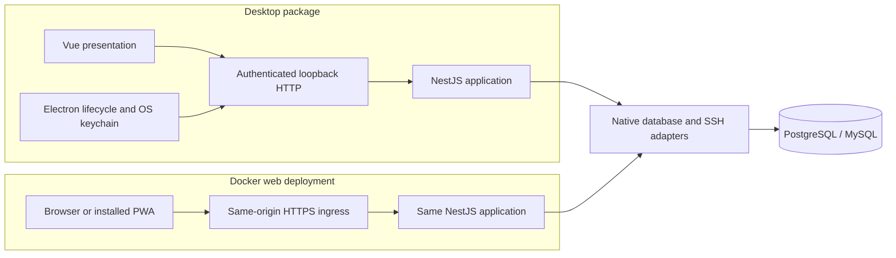

# Architecture

## Product decision

The desktop app is the primary end-user product: one installer and no external helper setup. Docker is a separate deployment of the same UI, contracts, and application logic. A conventional PWA alone cannot contain a normal NestJS runtime or open raw PostgreSQL/MySQL TCP connections. Electron provides that runtime locally; Docker provides it on a server. This avoids asking end users to install Node or manage a companion service.

## Dependency boundaries

`domain` contains type-only entities and repository/gateway interfaces. It does not depend on NestJS, Vue, filesystems, SQL drivers, or Electron. `application` coordinates connection management and browsing through constructor-injected ports and framework-independent errors; the Nest composition root supplies the adapters. `infrastructure` implements encrypted storage, PostgreSQL/MySQL clients, and SSH transport. `presentation` handles HTTP validation, authorization, and error mapping. The Nest composition root selects implementations.

Frontend `domain` exposes the typed contracts; `application/stores` coordinates user workflows and stale-request protection; `infrastructure/api` owns HTTP transport and session-token handling; `presentation` owns rendering and form interaction. Shared Zod schemas supply both server DTO validation and VeeValidate form validation. No duplicate form schema or ORM model is used. An ORM is deliberately unnecessary for introspecting arbitrary databases.

`AppModule.register` accepts a repository and optional database gateway at the boundary. `bootstrap` accepts runtime options; it never connects to a database merely by importing a module. Desktop and server composition reuse this entry point.

## Desktop lifecycle and credentials

Electron starts a loopback-only server on an OS-assigned port, with a fresh random bearer token per app launch. It opens the bundled frontend with a short-lived URL fragment handoff. The UI removes that fragment immediately and keeps the app session token in session storage. Database credentials are never stored there. The app denies new-window requests, remote navigation, renderer Node access, and permission requests. Its renderer is sandboxed and isolated.

Saved connections, private keys, and passwords are encrypted together using AES-256-GCM with a fresh 96-bit nonce per write. The desktop master key is encrypted using Electron safeStorage and the OS secret store. A missing/untrusted Linux secret store selects session-only mode. Existing vault decryption errors stop startup instead of overwriting data. Atomic, serialized writes prevent partial files and lost concurrent updates. There is one backend process per desktop profile; sharing the same data directory across processes is unsupported.

The Docker/server runtime uses the supplied 32-byte base64 master key instead of an OS keychain. That key must be retained separately from the encrypted data volume. Metadata responses redact secrets. SSH private keys are loaded through an explicit file picker and kept only in the encrypted vault; the app does not depend on the original key-file path after saving.

## Database reads

Every request opens a bounded native connection, begins a read-only transaction, executes a generated query, and cleans up the driver and SSH channel. No arbitrary SQL endpoint exists. Only SELECT/metadata queries are generated. Production accounts must independently have SELECT-only database grants. Read-only transactions are defense in depth, not a replacement for database grants or a guarantee about user-defined view functions.

The connection profile selects exactly one database. PostgreSQL schemas are listed within it; MySQL introspection is restricted to the selected database. SQL identifiers are quoted, sort/search columns must exist in introspected metadata, and search values use bound parameters. Percent and underscore are escaped for literal substring matching. Tables with a primary key receive deterministic primary-key tie breakers; tables without one show a pagination warning. Offset pagination can shift when other clients concurrently edit rows.

Queries time out after approximately 15 seconds; connection and SSH handshake timeouts are separate. At most eight active database operations run concurrently. Each page is capped at 1,000 rows and 4 MiB of serialized data. Long text and binary previews are bounded; large JSON cells can cause page truncation. Truncated results disable forward pagination and ask the user to reduce the page size. PostgreSQL/MySQL big integers remain strings.

There is no full-table count query or initial database download. Global table search can still require a database scan; narrow column filters and query timeouts limit disruption. There is no claim of constant-time deep offset pagination.

## Automatic schema diagrams

The diagram use case resolves the encrypted connection through the same repository and gateway ports as row browsing. A database adapter reads only bounded PostgreSQL catalogs or MySQL information_schema inside the existing read-only session. Queries bind the schema and table names as values. Composite FK order and self references are preserved. Only declared constraints become relationships; unknown relationships are not inferred. Cross-schema/out-of-limit references stay available as table details, with explicit omission counts.

The Vue application store handles metadata loading and stale-request protection. A pure layout function arranges connected components, including cycles and isolated tables. The presentation component adds SVG rendering, zoom, panning, drag positions and column details. Database names/types render as escaped text. Appearance preferences are local non-secret settings; data and credentials are never saved there.

## Network trust and offline behavior

SSH connections require a pinned SHA256 host-key fingerprint. Fingerprint discovery only fetches identity: users must compare it with a trusted administrator-provided value. It does not automatically establish trust. Agent, password and private-key authentication (including encrypted PEM keys) use the same pinning path. Agent mode requests signatures from the backend machine's existing SSH agent; it never copies the private key into the connection vault or forwards the agent to the remote server. Docker access to a host agent is opt-in through a mounted socket. An authenticated SSH-only test isolates SSH setup from database login and forwarding. TLS never disables CA/hostname verification; supply the certificate server name when connecting through a tunnel if needed.

Server mode is single-user with an explicit administrator token. The API uses bearer authorization, bounded JSON bodies, rate limits, no-store response headers, and sanitized, stage-specific connection errors. Upstream error text is never returned. Its frontend is served from the same origin with a restrictive CSP. CORS is only configurable for explicit development origins. Multi-user data separation is not implemented.

The PWA precaches only the application shell and static assets. API responses and credentials are never service-worker cached. Offline opening works after installation; local queries still need the local runtime, while remote queries require the target network. A remote Docker deployment cannot reach an end user's localhost automatically.

## Release contract

CI verifies types, shared validation, vault behavior, real drivers, SSH agent/password/key flows and failure diagnostics, browser behavior, and a running image. The release workflow gates installer packaging/image publication on verification. Native OS builds and publisher signing are distinct steps: Linux validation does not prove Windows/macOS native behavior. Public distribution requires certificate provisioning and macOS notarization. Versioned release artifacts are installed manually in v1.
